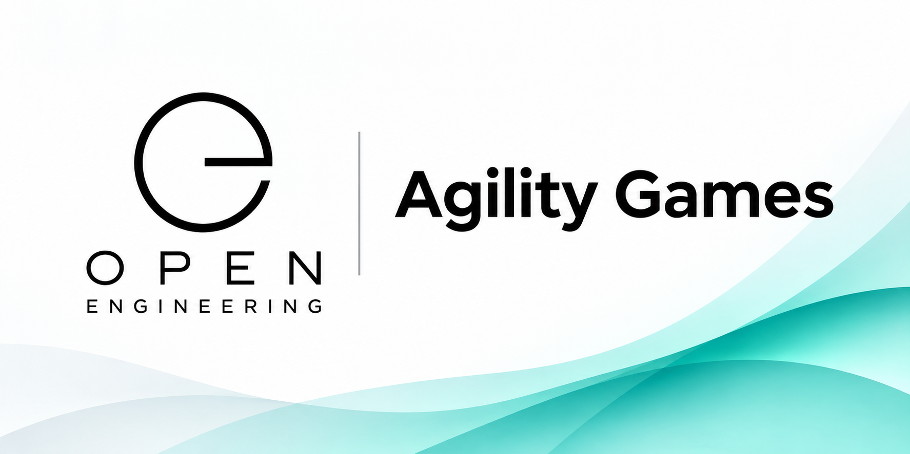

Agility Games

Assembling interactive business simulations from reusable gameboards, spaces, and capabilities.

Agility Games is an open engineering initiative for creating interactive, visual, and extensible business simulations. It combines the familiar experience of board games with software engineering, organizational decision-making, strategic planning, and experiential learning.

Rather than building each game from scratch, Agility Games assembles games from reusable building blocks.

Powered by the Open Engineering approach, Agility Games brings together Bricks, Capsules, Assemblies, and Products to create engaging simulations in which players explore challenges, make decisions, execute missions, and experience their consequences.

⸻

The Idea

Imagine a Monopoly-like gameboard where spaces represent real-world business and engineering activities.

Instead of buying properties, players might:

* Define a business strategy.
* Design a software architecture.
* Develop and test a solution.
* Address cybersecurity risks.
* Make architectural decisions.
* Execute engineering missions.
* Deliver a software release.
* Evaluate business outcomes.

Every decision can influence the game, its players, and the simulated organization.

Agility Games turns complex business and engineering challenges into interactive experiences.

From Building Games to Assembling Games

Traditional game development often produces tightly coupled implementations in which game logic, visualizations, interactions, and content are developed specifically for one game.

Agility Games takes a different approach.

A game is assembled from independently defined and reusable components.

Concept	Responsibility
Brick	A reusable model, definition, artifact, or other elementary component
Capsule	Encapsulated behavior, such as movement, scoring, missions, or narration
Assembly	A declarative composition of bricks, capsules, and other assemblies
Product	A playable game produced from an assembly
Gameboard	A navigable composition of gameboard spaces
Space	A logical location where players encounter activities, decisions, or events
Scene	A visual environment rendered using technologies such as Babylon.js

This separation allows game designers to reuse capabilities across multiple games without duplicating their implementations.

Gameboards and Spaces

A central concept within Agility Games is the Gameboard Assembly.

A gameboard consists of connected spaces, similar to traditional board games.

However, each space can represent a rich, interactive environment.

For example:

                      AGILITY GAME
    ┌────────────┬────────────┬────────────┐
    │     GO     │  Strategy  │  DevBench  │
    ├────────────┼────────────┼────────────┤
    │  Improve   │            │  Testing   │
    ├────────────┤            ├────────────┤
    │   Review   │            │  Security  │
    ├────────────┼────────────┼────────────┤
    │  Evaluate  │  Release   │   Deploy   │
    └────────────┴────────────┴────────────┘

Illustrative gameboard layout; individual games may define different spaces, connections, and rules.

Space Assemblies

Each space is independently defined and can provide:

* A visual representation.
* Game rules and interactions.
* Missions and challenges.
* Decisions and assessments.
* Architecture models and documentation.
* Contextual narration.
* Optional immersive 3D environments.

A space can be reused across multiple gameboards.

For example, a DevBench space could appear in a software engineering simulation, an enterprise transformation game, or an architecture training experience.

The gameboard determines where a space appears and how players reach it.

The Space Assembly determines what players encounter and can do there.

Three Levels of Visualization

Agility Games supports three complementary visualization levels.

1. Gameboard Overview

Players see the entire gameboard, including spaces, routes, player positions, and game progress.

2. Space Focus

Players navigate toward an individual space to inspect its models, available actions, missions, and decisions.

3. Space Immersion

Players can enter a detailed environment associated with a space, such as a virtual development environment, testing laboratory, or architecture review room.

These levels allow players to move naturally between strategic overview and operational detail.

Babylon.js Visualization

Agility Games proposes Babylon.js as a 3D visualization technology.

The recommended architecture uses a shared Babylon.js scene for the gameboard.

Individual Space Assemblies are represented by independently managed hierarchies of 3D objects, rather than requiring a separate rendering scene for every space.

More complex spaces may optionally provide dedicated immersive scenes.

This enables:

* Smooth camera transitions.
* Animated player movement.
* Gameboard overview and minimaps.
* Interactive 3D models.
* On-demand loading of detailed environments.
* Reuse of GLB and glTF assets.
* Integration with web-based user interfaces.

The visualization remains separate from the authoritative game state and rules.

Game Mechanics and Capabilities

Agility Games aims to support reusable behavioral capabilities through capsules.

Examples include:

Capsule	Responsibility
Rules	Validates game actions and constraints
Turns	Manages player turns and sequencing
Movement	Determines permitted movement between spaces
Scoring	Evaluates player decisions and outcomes
Missions	Coordinates interactive challenges
Decisions	Presents choices and their consequences
Assessments	Evaluates performance and compliance
Narration	Explains spaces, missions, and outcomes
Simulation	Models business and engineering consequences

These capabilities can be assembled differently for different games.

A strategy simulation may emphasize decisions and scoring, while a software engineering simulation may emphasize missions, assessments, and technical activities.

Declarative Game Composition

Agility Games aims to describe gameboards and spaces using declarative specifications.

For example:

id: agility-gameboard
kind: gameboard-assembly
name: Agility Gameboard
rendering:
  engine: babylonjs
  scene: gameboard
spaces:
  - id: go
    assembly: spaces/go
    position: [0, 0, 0]
  - id: strategy
    assembly: spaces/strategy
    position: [6, 0, 0]
  - id: devbench
    assembly: spaces/devbench
    position: [12, 0, 0]
connections:
  - from: go
    to: strategy
  - from: strategy
    to: devbench

A Gameboard Assembly resolves these definitions into a playable experience.

The specification describes the composition without prescribing every implementation detail.

Powered by Open Engineering

Agility Games applies the broader Open Engineering approach to the domain of interactive games and simulations.

The relationship can be expressed as:

Open Engineering
│
├── Bricks
│   └── Reusable definitions and artifacts
│
├── Capsules
│   └── Reusable behaviors and capabilities
│
├── Assemblies
│   └── Declarative compositions
│
├── Assembly
│   └── Composition and implementation mechanisms
│
└── Products
    └── Agility Game
        ├── Game Engine
        ├── Gameboard Assembly
        ├── Space Assemblies
        ├── Player Interactions
        └── Visualizations

Agility Games provides the game-specific definitions, capabilities, and compositions that enable such products.

Related Open Engineering Organizations

* Open Engineering Bricks — Reusable architectural building blocks.
* Open Engineering Capsules — Reusable behavioral capabilities.
* Open Engineering Assemblies — Declarative assembly definitions.
* Open Engineering Assembly — Assembly implementations.
* Open Engineering Architecture — Architectural models and exploration.
* Open Engineering Products — Product definitions.
* Open Engineering Narrators — Contextual narration capabilities.

Agility Games and Agility Game

The distinction between the platform and an individual game is intentional.

Agility Games defines the ecosystem for composing and delivering interactive games.

Agility Game is an example of a game product assembled using these capabilities.

This separation allows the same underlying architecture to support multiple game products, each with its own gameboard, rules, objectives, and experiences.

See also Agility Game.

Technology Direction

The proposed technology stack includes:

Technology	Purpose
Babylon.js	Interactive 3D gameboards and environments
SvelteKit	Web application and user interface
TypeScript	Application and game logic
glTF / GLB	Reusable 3D models
YAML / JSON	Declarative game and assembly definitions
GitHub	Source management, collaboration, and releases
Open Engineering	Reusable architectural composition and capabilities

Technology choices may evolve as implementations mature.

Architectural Principles

Agility Games follows several guiding principles:

1. Assemble rather than build. Reuse existing definitions, capabilities, and assemblies wherever possible.
2. Separate definitions from implementations. Game concepts should not depend on a particular rendering technology.
3. Separate game logic from visualization. The game engine remains authoritative.
4. Make spaces reusable. A space should not be tied unnecessarily to one gameboard.
5. Keep the gameboard navigable. Players should always be able to understand their location and the broader context.
6. Support progressive immersion. Move from overview to focus to detailed interaction.
7. Prefer declarative composition. Describe games through structured definitions rather than hardcoded arrangements.
8. Design for extensibility. New spaces, capsules, missions, and gameboards should be composable without redesigning the platform.

Vision

Agility Games aims to make complex business and software engineering challenges understandable through interactive simulation.

By combining familiar game mechanics with reusable Open Engineering capabilities, it provides a foundation for experiences that help participants explore systems, experiment with decisions, and understand consequences.

The long-term opportunity extends beyond a single gameboard.

Agility Games can become a platform for assembling many different simulations, learning environments, and collaborative experiences from a shared ecosystem of reusable components.

⸻

Agility Games — Don’t just play the game. Assemble the experience.
